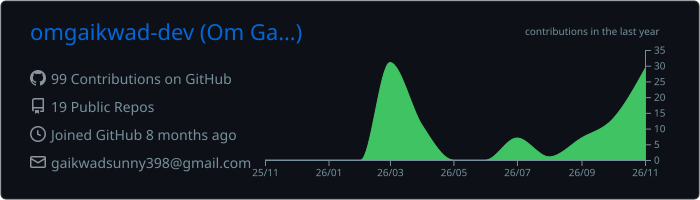
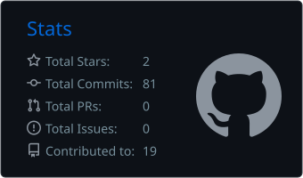
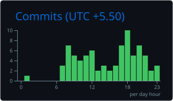
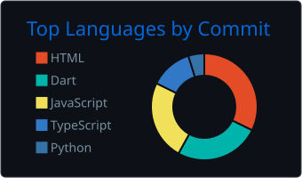
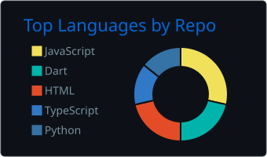

<!--
  PROFILE README · Om Gaikwad
  Repository: omgaikwad-dev/omgaikwad-dev

  Local SVG assets:
  assets/banner.svg
  assets/section-01.svg ... assets/section-07.svg
  assets/footer.svg

  Generated assets:
  profile-summary-card-output/
  output/github-contribution-grid-snake.svg
-->

 

 

<!-- ═══════════ 01 ABOUT ME ═══════════ -->

&nbsp;

<table>
<tr>
<td width="58%" valign="top">

<b>👋 𝑯𝒆𝒍𝒍𝒐, 𝑰'𝒎 𝑶𝒎 𝑮𝒂𝒊𝒌𝒘𝒂𝒅!</b> 
𝐼'𝑚 𝑎 <b>𝑭𝒖𝒍𝒍 𝑺𝒕𝒂𝒄𝒌 𝑫𝒆𝒗𝒆𝒍𝒐𝒑𝒆𝒓 𝒂𝒏𝒅 𝑨𝑰 𝑩𝒖𝒊𝒍𝒅𝒆𝒓</b> 𝑝𝑎𝑠𝑠𝑖𝑜𝑛𝑎𝑡𝑒 𝑎𝑏𝑜𝑢𝑡 𝑐𝑟𝑒𝑎𝑡𝑖𝑛𝑔 𝑚𝑒𝑎𝑛𝑖𝑛𝑔𝑓𝑢𝑙 𝑑𝑖𝑔𝑖𝑡𝑎𝑙 𝑝𝑟𝑜𝑑𝑢𝑐𝑡𝑠 𝑡ℎ𝑟𝑜𝑢𝑔ℎ 𝑡𝑒𝑐ℎ𝑛𝑜𝑙𝑜𝑔𝑦. 𝐼 𝑒𝑛𝑗𝑜𝑦 𝑏𝑢𝑖𝑙𝑑𝑖𝑛𝑔 𝑤𝑒𝑏 𝑎𝑝𝑝𝑠, 𝑚𝑜𝑏𝑖𝑙𝑒 𝑎𝑝𝑝𝑠, 𝑖𝑛𝑡𝑒𝑙𝑙𝑖𝑔𝑒𝑛𝑡 𝑠𝑦𝑠𝑡𝑒𝑚𝑠, 𝑎𝑛𝑑 𝑝𝑟𝑎𝑐𝑡𝑖𝑐𝑎𝑙 𝑠𝑜𝑙𝑢𝑡𝑖𝑜𝑛𝑠 𝑡𝑜 𝑟𝑒𝑎𝑙-𝑤𝑜𝑟𝑙𝑑 𝑝𝑟𝑜𝑏𝑙𝑒𝑚𝑠.
<ul>
<li>🔭 𝐸𝑥𝑝𝑙𝑜𝑟𝑖𝑛𝑔 𝐴𝐼, 𝑀𝑎𝑐ℎ𝑖𝑛𝑒 𝐿𝑒𝑎𝑟𝑛𝑖𝑛𝑔 𝑎𝑛𝑑 𝑖𝑛𝑡𝑒𝑙𝑙𝑖𝑔𝑒𝑛𝑡 𝑎𝑝𝑝𝑙𝑖𝑐𝑎𝑡𝑖𝑜𝑛𝑠</li>
<li>🌱 𝐼𝑚𝑝𝑟𝑜𝑣𝑖𝑛𝑔 𝑚𝑦 𝑠𝑘𝑖𝑙𝑙𝑠 𝑖𝑛 𝐷𝑆𝐴 𝑎𝑛𝑑 𝑠𝑜𝑓𝑡𝑤𝑎𝑟𝑒 𝑒𝑛𝑔𝑖𝑛𝑒𝑒𝑟𝑖𝑛𝑔</li>
<li>💻 𝐵𝑢𝑖𝑙𝑑𝑖𝑛𝑔 𝑓𝑢𝑙𝑙-𝑠𝑡𝑎𝑐𝑘 𝑤𝑒𝑏 𝑎𝑛𝑑 𝑚𝑜𝑏𝑖𝑙𝑒 𝑎𝑝𝑝𝑙𝑖𝑐𝑎𝑡𝑖𝑜𝑛𝑠</li>
<li>🤖 𝐼𝑛𝑡𝑒𝑟𝑒𝑠𝑡𝑒𝑑 𝑖𝑛 𝐴𝐼 𝑎𝑔𝑒𝑛𝑡𝑠 𝑎𝑛𝑑 𝑎𝑢𝑡𝑜𝑚𝑎𝑡𝑖𝑜𝑛</li>
<li>🏆 3× 𝐻𝑎𝑐𝑘𝑎𝑡ℎ𝑜𝑛 𝑊𝑖𝑛𝑛𝑒𝑟</li>
<li>🤝 𝑂𝑝𝑒𝑛 𝑡𝑜 𝑐𝑜𝑙𝑙𝑎𝑏𝑜𝑟𝑎𝑡𝑖𝑛𝑔 𝑤𝑖𝑡ℎ 𝑑𝑒𝑣𝑒𝑙𝑜𝑝𝑒𝑟𝑠 𝑎𝑛𝑑 𝑓𝑜𝑢𝑛𝑑𝑒𝑟𝑠</li>
</ul>

</td>
<td width="42%" valign="top">

<b>🧬 𝑫𝒆𝒗𝒆𝒍𝒐𝒑𝒆𝒓 𝑷𝒓𝒐𝒇𝒊𝒍𝒆</b>

| | |
|---|---|
| 𝑹𝒐𝒍𝒆 | 𝐹𝑢𝑙𝑙 𝑆𝑡𝑎𝑐𝑘 𝐷𝑒𝑣𝑒𝑙𝑜𝑝𝑒𝑟 |
| 𝑭𝒐𝒄𝒖𝒔 | 𝐴𝐼 + 𝑊𝑒𝑏 + 𝑀𝑜𝑏𝑖𝑙𝑒 |
| 𝑳𝒐𝒄𝒂𝒕𝒊𝒐𝒏 | 𝑃𝑢𝑛𝑒, 𝑀𝑎ℎ𝑎𝑟𝑎𝑠ℎ𝑡𝑟𝑎, 𝐼𝑛𝑑𝑖𝑎 |
| 𝑬𝒅𝒖𝒄𝒂𝒕𝒊𝒐𝒏 | 𝐶𝑜𝑚𝑝𝑢𝑡𝑒𝑟 𝐸𝑛𝑔𝑖𝑛𝑒𝑒𝑟𝑖𝑛𝑔 |
| 𝑪𝒐𝒍𝒍𝒆𝒈𝒆 | 𝑆𝑚𝑡. 𝐾𝑎𝑠ℎ𝑖𝑏𝑎𝑖 𝑁𝑎𝑣𝑎𝑙𝑒 𝐶𝑜𝑙𝑙𝑒𝑔𝑒 𝑜𝑓 𝐸𝑛𝑔𝑖𝑛𝑒𝑒𝑟𝑖𝑛𝑔 |
| 𝑮𝒐𝒂𝒍 | 𝐴𝐼 𝐸𝑛𝑔𝑖𝑛𝑒𝑒𝑟 |
| 𝑰𝒏𝒕𝒆𝒓𝒆𝒔𝒕𝒔 | 𝐴𝐼, 𝐷𝑒𝑣𝑒𝑙𝑜𝑝𝑚𝑒𝑛𝑡, 𝐼𝑜𝑇 |

</td>
</tr>
</table>

 

<!-- ═══════════ 02 WHAT I BUILD ═══════════ -->

&nbsp;

| 𝐅𝐎𝐂𝐔𝐒 𝐀𝐑𝐄𝐀 | 𝐎𝐕𝐄𝐑𝐕𝐈𝐄𝐖 | 𝐂𝐎𝐑𝐄 𝐒𝐓𝐀𝐂𝐊 |
|:--|:--|:--:|
| 𝑾𝒆𝒃 𝑫𝒆𝒗𝒆𝒍𝒐𝒑𝒎𝒆𝒏𝒕 | 𝑅𝑒𝑠𝑝𝑜𝑛𝑠𝑖𝑣𝑒, 𝑚𝑜𝑑𝑒𝑟𝑛 𝑤𝑒𝑏 𝑎𝑝𝑝𝑙𝑖𝑐𝑎𝑡𝑖𝑜𝑛𝑠 𝑤𝑖𝑡ℎ 𝑖𝑛𝑡𝑢𝑖𝑡𝑖𝑣𝑒 𝑢𝑠𝑒𝑟 𝑒𝑥𝑝𝑒𝑟𝑖𝑒𝑛𝑐𝑒𝑠. |  |
| 𝑴𝒐𝒃𝒊𝒍𝒆 𝑫𝒆𝒗𝒆𝒍𝒐𝒑𝒎𝒆𝒏𝒕 | 𝐶𝑟𝑜𝑠𝑠-𝑝𝑙𝑎𝑡𝑓𝑜𝑟𝑚 𝑚𝑜𝑏𝑖𝑙𝑒 𝑎𝑝𝑝𝑙𝑖𝑐𝑎𝑡𝑖𝑜𝑛𝑠 𝑎𝑛𝑑 𝑛𝑎𝑡𝑖𝑣𝑒 𝐴𝑛𝑑𝑟𝑜𝑖𝑑 𝑒𝑥𝑝𝑒𝑟𝑖𝑒𝑛𝑐𝑒𝑠. |  |
| 𝑨𝑰 & 𝑩𝒂𝒄𝒌𝒆𝒏𝒅 | 𝐼𝑛𝑡𝑒𝑙𝑙𝑖𝑔𝑒𝑛𝑡 𝑎𝑝𝑝𝑙𝑖𝑐𝑎𝑡𝑖𝑜𝑛𝑠, 𝐴𝑃𝐼𝑠, 𝑎𝑢𝑡𝑜𝑚𝑎𝑡𝑖𝑜𝑛 𝑎𝑛𝑑 𝑠𝑐𝑎𝑙𝑎𝑏𝑙𝑒 𝑏𝑎𝑐𝑘𝑒𝑛𝑑 𝑠𝑦𝑠𝑡𝑒𝑚𝑠. |  |

 

<!-- ═══════════ 03 TECH UNIVERSE ═══════════ -->

&nbsp;

| 𝐂𝐀𝐓𝐄𝐆𝐎𝐑𝐘 | 𝐓𝐄𝐂𝐇𝐍𝐎𝐋𝐎𝐆𝐈𝐄𝐒 |
|:--|:--:|
| 𝑳𝒂𝒏𝒈𝒖𝒂𝒈𝒆𝒔 |  |
| 𝑭𝒓𝒂𝒎𝒆𝒘𝒐𝒓𝒌𝒔 & 𝑳𝒊𝒃𝒓𝒂𝒓𝒊𝒆𝒔 |  |
| 𝑫𝒂𝒕𝒂𝒃𝒂𝒔𝒆𝒔 & 𝑪𝒍𝒐𝒖𝒅 |  |
| 𝑻𝒐𝒐𝒍𝒔 & 𝑷𝒍𝒂𝒕𝒇𝒐𝒓𝒎𝒔 |  |

 

<!-- ═══════════ 04 FEATURED PROJECTS ═══════════ -->

&nbsp;

<b>⭐ 𝑭𝒆𝒂𝒕𝒖𝒓𝒆𝒅 𝑷𝒓𝒐𝒋𝒆𝒄𝒕𝒔</b>

| 𝐏𝐑𝐎𝐉𝐄𝐂𝐓 | 𝐀𝐁𝐎𝐔𝐓 | 𝐒𝐓𝐀𝐂𝐊 | 𝐋𝐀𝐒𝐓 𝐂𝐎𝐌𝐌𝐈𝐓 | 𝐋𝐈𝐍𝐊 |
|:--|:--|:--:|:--:|:--:|
| [🧠 𝑴𝒊𝒏𝒅𝑾𝒆𝒂𝒍𝒕𝒉 𝑨𝑰](https://github.com/omgaikwad-dev/mindwealth_ai) | 𝐴𝐼-𝑓𝑜𝑐𝑢𝑠𝑒𝑑 𝑎𝑝𝑝𝑙𝑖𝑐𝑎𝑡𝑖𝑜𝑛 𝑒𝑥𝑝𝑙𝑜𝑟𝑖𝑛𝑔 𝑖𝑛𝑡𝑒𝑙𝑙𝑖𝑔𝑒𝑛𝑡 𝑠𝑜𝑙𝑢𝑡𝑖𝑜𝑛𝑠. |  |  |  |
| [🤖 𝑨𝑰 𝑨𝒈𝒆𝒏𝒕](https://github.com/omgaikwad-dev/AI_Agent) | 𝐸𝑥𝑝𝑙𝑜𝑟𝑖𝑛𝑔 𝐴𝐼 𝑎𝑔𝑒𝑛𝑡𝑠, 𝑖𝑛𝑡𝑒𝑙𝑙𝑖𝑔𝑒𝑛𝑡 𝑤𝑜𝑟𝑘𝑓𝑙𝑜𝑤𝑠 𝑎𝑛𝑑 𝑎𝑢𝑡𝑜𝑚𝑎𝑡𝑖𝑜𝑛. |  |  |  |
| [🐾 𝑷𝒂𝒘𝑷𝒆𝒅𝒊𝒂](https://github.com/omgaikwad-dev/PawPedia) | 𝐴 𝑠𝑜𝑓𝑡𝑤𝑎𝑟𝑒 𝑑𝑒𝑣𝑒𝑙𝑜𝑝𝑚𝑒𝑛𝑡 𝑝𝑟𝑜𝑗𝑒𝑐𝑡 𝑓𝑟𝑜𝑚 𝑚𝑦 𝑝𝑜𝑟𝑡𝑓𝑜𝑙𝑖𝑜. |  |  |  |
| [✨ 𝑪𝒍𝒂𝒊𝒓](https://github.com/omgaikwad-dev/clair) | 𝐴 𝑤𝑒𝑏 𝑑𝑒𝑣𝑒𝑙𝑜𝑝𝑚𝑒𝑛𝑡 𝑝𝑟𝑜𝑗𝑒𝑐𝑡 𝑓𝑟𝑜𝑚 𝑚𝑦 𝑝𝑜𝑟𝑡𝑓𝑜𝑙𝑖𝑜. |  |  |  |

<b>🚀 𝑶𝒕𝒉𝒆𝒓 𝑷𝒓𝒐𝒋𝒆𝒄𝒕𝒔 &amp; 𝑪𝒐𝒏𝒄𝒆𝒑𝒕𝒔</b>

| 𝐏𝐑𝐎𝐉𝐄𝐂𝐓 | 𝐃𝐄𝐒𝐂𝐑𝐈𝐏𝐓𝐈𝐎𝐍 | 𝐅𝐎𝐂𝐔𝐒 |
|---|---|---|
| 𝑺𝒉𝒊𝒍𝒑𝑺𝒆𝒕𝒖 | 𝐴𝐼-𝑑𝑟𝑖𝑣𝑒𝑛 𝑑𝑖𝑔𝑖𝑡𝑎𝑙 𝑐𝑎𝑡𝑎𝑙𝑜𝑔𝑢𝑖𝑛𝑔 𝑎𝑛𝑑 𝑚𝑎𝑟𝑘𝑒𝑡 𝑙𝑖𝑛𝑘𝑎𝑔𝑒 𝑐𝑜𝑛𝑐𝑒𝑝𝑡 𝑓𝑜𝑟 𝑚𝑎𝑟𝑔𝑖𝑛𝑎𝑙𝑖𝑧𝑒𝑑 𝑎𝑟𝑡𝑖𝑠𝑎𝑛𝑠. | 𝐴𝐼 · 𝑆𝑜𝑐𝑖𝑎𝑙 𝐼𝑚𝑝𝑎𝑐𝑡 |
| 𝑪𝒉𝒖𝒓𝒏𝑮𝒖𝒂𝒓𝒅 𝑨𝑰 | 𝐶𝑢𝑠𝑡𝑜𝑚𝑒𝑟 𝑐ℎ𝑢𝑟𝑛 𝑎𝑛𝑎𝑙𝑦𝑠𝑖𝑠 𝑎𝑛𝑑 𝑝𝑟𝑒𝑑𝑖𝑐𝑡𝑖𝑜𝑛 𝑎𝑝𝑝𝑙𝑖𝑐𝑎𝑡𝑖𝑜𝑛. | 𝑀𝑎𝑐ℎ𝑖𝑛𝑒 𝐿𝑒𝑎𝑟𝑛𝑖𝑛𝑔 |
| 𝑺𝒂𝒍𝒆𝒔𝑽𝒊𝒔𝒊𝒐𝒏 | 𝑅𝑒𝑡𝑎𝑖𝑙 𝑠𝑎𝑙𝑒𝑠 𝑎𝑛𝑎𝑙𝑦𝑠𝑖𝑠 𝑎𝑛𝑑 𝑣𝑖𝑠𝑢𝑎𝑙 𝑟𝑒𝑝𝑜𝑟𝑡𝑖𝑛𝑔. | 𝑃𝑦𝑡ℎ𝑜𝑛 · 𝑆𝑄𝐿 · 𝐴𝑛𝑎𝑙𝑦𝑡𝑖𝑐𝑠 |
| 𝑭𝒓𝒂𝒖𝒅 𝑫𝒆𝒕𝒆𝒄𝒕𝒊𝒐𝒏 | 𝑀𝑎𝑐ℎ𝑖𝑛𝑒 𝑙𝑒𝑎𝑟𝑛𝑖𝑛𝑔-𝑏𝑎𝑠𝑒𝑑 𝑓𝑟𝑎𝑢𝑑 𝑑𝑒𝑡𝑒𝑐𝑡𝑖𝑜𝑛 𝑝𝑟𝑜𝑗𝑒𝑐𝑡. | 𝑀𝑎𝑐ℎ𝑖𝑛𝑒 𝐿𝑒𝑎𝑟𝑛𝑖𝑛𝑔 |
| 𝑯𝒐𝒖𝒔𝒆 𝑷𝒓𝒊𝒄𝒆 𝑷𝒓𝒆𝒅𝒊𝒄𝒕𝒊𝒐𝒏 | 𝑃𝑟𝑒𝑑𝑖𝑐𝑡𝑖𝑣𝑒 𝑚𝑜𝑑𝑒𝑙𝑙𝑖𝑛𝑔 𝑓𝑜𝑟 ℎ𝑜𝑢𝑠𝑒 𝑝𝑟𝑖𝑐𝑒𝑠. | 𝑀𝑎𝑐ℎ𝑖𝑛𝑒 𝐿𝑒𝑎𝑟𝑛𝑖𝑛𝑔 |

 

<!-- ═══════════ 05 MY JOURNEY ═══════════ -->

&nbsp;

<table>
<tr>
<td width="10%" align="center">🎓</td>
<td width="90%"><b>𝑺𝒎𝒕. 𝑲𝒂𝒔𝒉𝒊𝒃𝒂𝒊 𝑵𝒂𝒗𝒂𝒍𝒆 𝑪𝒐𝒍𝒍𝒆𝒈𝒆 𝒐𝒇 𝑬𝒏𝒈𝒊𝒏𝒆𝒆𝒓𝒊𝒏𝒈</b> · 𝐶𝑜𝑚𝑝𝑢𝑡𝑒𝑟 𝐸𝑛𝑔𝑖𝑛𝑒𝑒𝑟𝑖𝑛𝑔</td>
</tr>
<tr>
<td align="center">💼</td>
<td><b>𝑺𝒆𝒕𝒄𝒐𝒅𝒆𝒓𝒔</b> · 𝐹𝑢𝑙𝑙 𝑆𝑡𝑎𝑐𝑘 𝐷𝑒𝑣𝑒𝑙𝑜𝑝𝑒𝑟</td>
</tr>
<tr>
<td align="center">🌐</td>
<td><b>𝑺𝑲𝑵 𝑰𝑬𝑬𝑬 𝑺𝒕𝒖𝒅𝒆𝒏𝒕 𝑩𝒓𝒂𝒏𝒄𝒉</b> · 𝑊𝑒𝑏 𝐷𝑒𝑣𝑒𝑙𝑜𝑝𝑚𝑒𝑛𝑡 𝐿𝑒𝑎𝑑</td>
</tr>
<tr>
<td align="center">🏆</td>
<td><b>𝑯𝒂𝒄𝒌𝒂𝒕𝒉𝒐𝒏𝒔</b> · 3× 𝐻𝑎𝑐𝑘𝑎𝑡ℎ𝑜𝑛 𝑊𝑖𝑛𝑛𝑒𝑟</td>
</tr>
</table>

 

<!-- ═══════════ 06 GITHUB OBSERVATORY ═══════════ -->

&nbsp;

<picture>
  <source media="(prefers-color-scheme: dark)" srcset="./profile-summary-card-output/github_dark/0-profile-details.svg"/>
  <source media="(prefers-color-scheme: light)" srcset="./profile-summary-card-output/github/0-profile-details.svg"/>
  
</picture>
 
<picture>
  <source media="(prefers-color-scheme: dark)" srcset="./profile-summary-card-output/github_dark/3-stats.svg"/>
  <source media="(prefers-color-scheme: light)" srcset="./profile-summary-card-output/github/3-stats.svg"/>
  
</picture>
<picture>
  <source media="(prefers-color-scheme: dark)" srcset="./profile-summary-card-output/github_dark/4-productive-time.svg"/>
  <source media="(prefers-color-scheme: light)" srcset="./profile-summary-card-output/github/4-productive-time.svg"/>
  
</picture>
 
<picture>
  <source media="(prefers-color-scheme: dark)" srcset="./profile-summary-card-output/github_dark/2-most-commit-language.svg"/>
  <source media="(prefers-color-scheme: light)" srcset="./profile-summary-card-output/github/2-most-commit-language.svg"/>
  
</picture>
<picture>
  <source media="(prefers-color-scheme: dark)" srcset="./profile-summary-card-output/github_dark/1-repos-per-language.svg"/>
  <source media="(prefers-color-scheme: light)" srcset="./profile-summary-card-output/github/1-repos-per-language.svg"/>
  
</picture>

 

 

<!-- ═══════════ 07 CONTRIBUTION FLOW ═══════════ -->

&nbsp;

<picture>
  <source media="(prefers-color-scheme: dark)" srcset="https://raw.githubusercontent.com/omgaikwad-dev/omgaikwad-dev/output/github-contribution-grid-snake-dark.svg"/>
  <source media="(prefers-color-scheme: light)" srcset="https://raw.githubusercontent.com/omgaikwad-dev/omgaikwad-dev/output/github-contribution-grid-snake.svg"/>
  
</picture>

 

<!-- ═══════════ CONNECT ═══════════ -->

